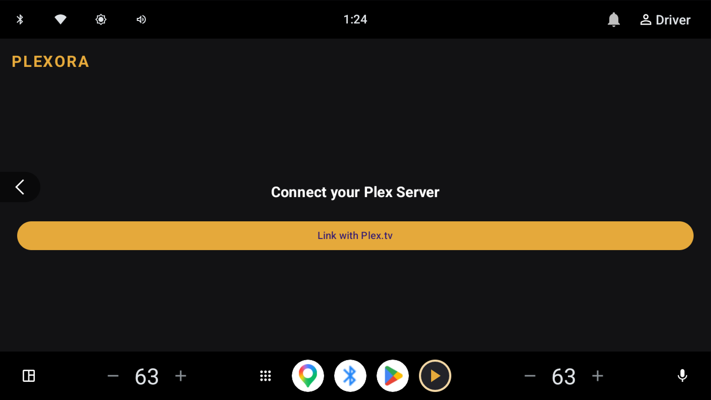
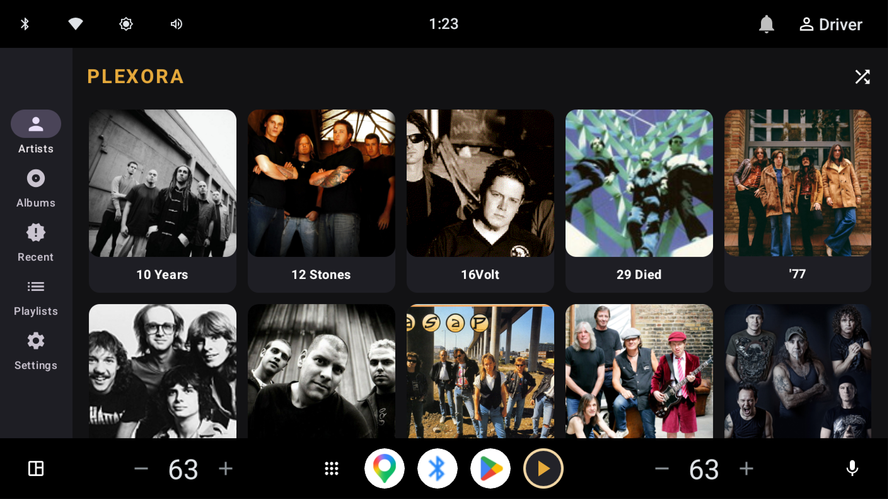
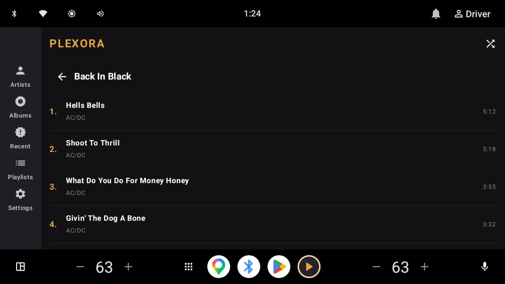
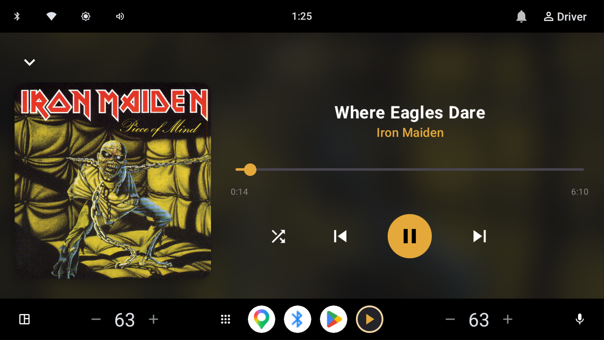

# Plexora

Plexora is a modern, lightweight Plex music client for **Android Automotive OS** and **Android mobile**.

## Product flavors

| Flavor | Target | UI |
|--------|--------|-----|
| **automotive** | Play Store / AAOS head units | System media browser and player (Media3 `MediaLibraryService`) |
| **mobile** | Phones and tablets | Full Jetpack Compose app with launcher, browse, and immersive player |

On Ford, GM, and other AAOS vehicles, the **automotive** build appears in the vehicle's native media app — not as a standalone Compose launcher. Browsing, artwork, shuffle, and playback are driven by `PlexMediaLibraryService` and the host system's UI.

The **mobile** flavor includes `MainActivity` with the custom Compose interface shown in the screenshots below.

## Features

- **System media integration**: Media3 implementation for AAOS media center, steering wheel controls, and instrument cluster metadata.
- **Expanded browse tree**: Artists, Albums, Recently Added, Playlists, plus contextual shuffle at each level.
- **Artwork via ContentProvider**: Plex images are proxied as local `content://` URIs for AAOS compatibility.
- **Contextual shuffle**: Library, artist, album, playlist, and section shuffles via Plex play queues.
- **Search**: Artists, albums, and tracks via the system media search UI.
- **Plex linking**: PIN auth at `plex.tv/link` through Sign In (automotive) or in-app setup (mobile).

## Screenshots (mobile flavor)

1. **Server Setup**  
     
   *Linking a Plex server using the secure PIN-based authentication flow.*

2. **Music Library**  
     
   *Browsing the artist library in the mobile Compose UI.*

3. **Playlist & Shuffle**  
     
   *Playlist track list with contextual shuffle.*

4. **Now Playing**  
     
   *Immersive playback screen with large controls and blurred background artwork.*

## Build

```bash
# Automotive (Play Store / AAOS)
./gradlew bundleAutomotiveRelease

# Mobile
./gradlew bundleMobileRelease
```

Version codes: mobile uses `appVersionCode`; automotive adds `1_000_000`.

| Flavor | `versionCode` | `versionName` | `targetSdk` |
|--------|---------------|---------------|-------------|
| **mobile** | 11 | 1.0 | 36 (Play phone/tablet updates) |
| **automotive** | 1000011 | 1.0 | 35 (AAOS) |

### Google Play target API levels

Phone and tablet builds (**mobile**) must target **API 36+** for Play updates. **automotive** stays on **API 35**, which matches Android Automotive OS requirements. Both flavors share `compileSdk = 37` in Gradle; only `targetSdk` differs by flavor.

### Signed release (Android Studio)

1. Sync Gradle after any version bump (`appVersionCode` in `app/build.gradle.kts`).
2. Select the **mobileRelease** or **automotiveRelease** build variant.
3. **Build → Generate Signed App Bundle / APK** → **Android App Bundle**, sign with your Play upload keystore.
4. Upload the `.aab` to Play Console (same app listing; use **Form factors** / dedicated **Android Automotive OS** track for `automotiveRelease` when configured).

Unsigned CI-style bundles (debug-signed) land under:

- `app/build/outputs/bundle/mobileRelease/app-mobile-release.aab`
- `app/build/outputs/bundle/automotiveRelease/app-automotive-release.aab`

Release builds use R8 minify and resource shrinking; run `./gradlew bundleMobileRelease bundleAutomotiveRelease` locally to catch ProGuard issues before signing in Studio.

## Play Console (review access)

Plexora requires a linked Plex account and a **Music** library on the chosen Plex server. Until setup completes, the media browser shows a sign-in error with **Set up Plexora** (mobile/Android Auto opens `SignInActivity`; AAOS uses the same PIN setup flow from the vehicle media browser).

### App content (sign-in instructions)

Path: **Monitor and improve** → **Policy and programs** → **App content**.

- **App access**: **All or some functionality is restricted** (Plex login + music library).
- **Sign-in details**: **Manage** → **+ Add new instructions** (Play limits each instruction set to **500 characters**; add **two** sets—one for phone/Android Auto, one for Android Automotive OS). Plex uses **PIN linking** at https://plex.tv/link (no shared test password). **Save**, then **Publishing overview** → **Send for review** when only policy text changed.

Also useful: **Test and release** → **Advanced settings** → **Form factors** → **Android Automotive OS** (screenshots, dedicated track); **Testing notes** on the release that ships `app-automotive-release.aab`.

Help: [Prepare your app for review (sign-in details)](https://support.google.com/googleplay/android-developer/answer/9859455).

**Reference flow (not limited to 500 chars):**

| Audience | Setup entry |
|----------|-------------|
| **Phone** | Launcher app → **Link with Plex.tv** → PIN → server → **Select Music Section** → **Connect and Import** |
| **Android Auto** | Complete phone setup first, then Plexora in the AA media app list |
| **Android Automotive OS** | Vehicle media browser → **Set up Plexora** → same PIN / server / music section steps on the head unit |

Movies-only or empty servers fail at music library selection—reviewers need a server with a Plex **Music** library.

Playback from an album or playlist queues remaining tracks in order (or shuffled via Shuffle items). Large libraries are loaded in pages so artists and albums beyond the first screen remain browsable.

## Release notes (version 11)

Draft for Play Console (**mobileRelease** version code **11**, **automotiveRelease** **1000011**). More items expected before ship.

### Mobile (version code 11)

- Single **Browse** tab with Artists / Albums toggle (compact landscape row; shuffle on that row in landscape)
- Full-width now playing sheet in landscape; stable artwork sizing while dragging the sheet

### Automotive (version code 1000011)

- Shared library/playback changes only if applicable; AAOS browse UI unchanged unless noted before release

## Release notes (version 10)

Copy into Play Console for **mobileRelease** (version code **10**) and **automotiveRelease** (version code **1000010**).

### Mobile (version code 10)

- Android Auto: register setup activity on phone builds; clearer “no music library” setup errors
- Library browse cache (stale-while-revalidate) for faster tab switching
- Browse polish: section titles in the top bar, square grid tiles, compact landscape chrome
- Full-screen now playing and Up next queue with slide-to-dismiss (modal sheets)
- Square artwork on mini player and full player
- Dependency refresh (Gradle version catalog, Media3 1.11, Compose BOM 2026.09)
- Fix playback after Media3 upgrade (session commands, stream URI resolution)

### Automotive (version code 1000010)

- Same shared playback and Plex client fixes as mobile (Media3 session connect, play queues, stream URIs)
- Dependency updates aligned with mobile; AAOS browse UI unchanged (system media browser)

## Technical stack

- **UI (mobile)**: Jetpack Compose
- **Media**: Media3 / ExoPlayer
- **Network**: OkHttp 5 & Plex API
- **Images**: Coil 2 (mobile), `ArtworkProvider` ContentProvider (automotive)
- **Persistence**: SharedPreferences for session and playback state recovery

## Getting started

1. Clone the repository.
2. Open the project in Android Studio.
3. Select the **mobile** or **automotive** build variant.
4. Deploy to a device or AAOS emulator.
5. Link your Plex account (Sign In on automotive; in-app setup on mobile).

## License

This project is licensed under the MIT License.
