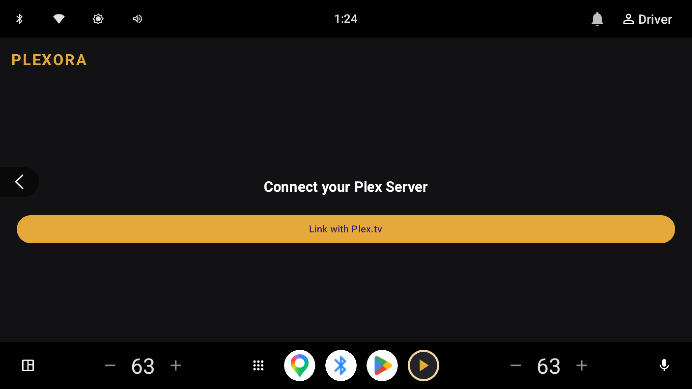
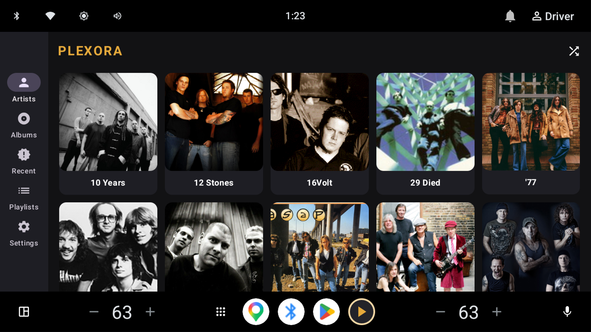
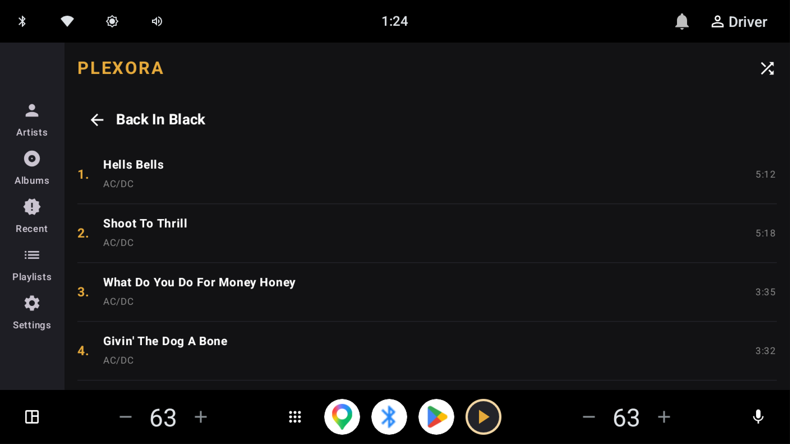
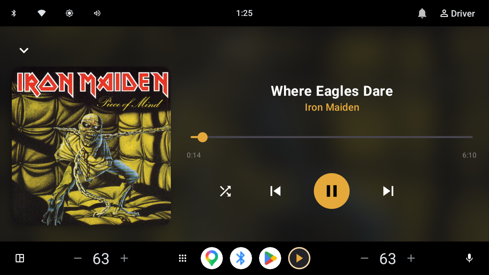

# Plexora

Plexora is a Plex **music** client for Android phones, tablets, and in-vehicle systems.

> **Looking for testers** — Plexora is under active development and I am especially looking for people who can exercise the **Android Automotive OS** build on real hardware (Ford **Digital Experience**, GM, Volvo, etc.). Emulators and the **Android Auto Desktop Head Unit (DHU)** do not reproduce OEM head-unit browse/playback UI; car feedback is invaluable. If you are interested, please **[open a GitHub issue](https://github.com/rickhall/plexora/issues/new)** or contact me via the channel linked on the [Play Store listing](https://play.google.com/store/apps/details?id=org.ungoverned.plexora) once you have the app installed.

## Two Play Store releases, three user experiences

Plexora ships as **two app bundles** from one codebase (Gradle product flavors). Depending on where you run it, you see one of **three** interfaces:

| User experience | What you use | Plexora build | Who draws browse & playback |
|-----------------|--------------|---------------|-----------------------------|
| **Mobile app** | Phone or tablet launcher | `mobile` AAB | **Plexora** — Jetpack Compose (`MainActivity`) |
| **Android Auto** (projected) | Phone in the car; car shows Android Auto | `mobile` AAB (same install as mobile) | **Android Auto** on the car display; Plexora supplies media via `PlexMediaLibraryService` |
| **Android Automotive OS** (built-in) | Native media app on an AAOS head unit (e.g. Ford Digital Experience) | `automotive` AAB | **The vehicle OEM** — Plexora exposes a Media3 `MediaLibraryService` browse tree and playback session |

Shared backend logic (Plex API, play queues, artwork, auth) lives in the main source set; only manifests, some activities, and the mobile UI differ by flavor.

**Automotive OS settings and setup** (`SettingsActivity`, `SignInActivity`) are simple full-screen flows Plexora provides when the host opens app preferences or when linking Plex is required. They are **not** the same UI as the OEM media browser — that is expected on AAOS.

## Features

- **Plex linking** — PIN flow at [plex.tv/link](https://plex.tv/link); pick a server and **Music** library section.
- **Browse** — Artists, albums, recently added, playlists; contextual shuffle at library, artist, album, and playlist levels (where the host UI exposes browse actions).
- **Playback** — Queues from albums/playlists; shuffle; Media3 session for steering-wheel and cluster metadata where supported.
- **Search** — Artists, albums, and tracks via system media search (automotive / Android Auto).
- **Artwork** — `content://` artwork proxy on automotive for host compatibility; Coil on mobile.
- **Mobile-only UI** — Unified Browse hub, now playing sheet, queue, track menus (album / artist), artist album sort (title or year), album duration badges, library cache, and related polish.

## Screenshots (mobile app only)

Automotive OS and Android Auto use the car’s media UI; screenshots below are the **mobile** Compose app.

1. **Server setup** —   
2. **Music library** —   
3. **Playlist & shuffle** —   
4. **Now playing** —   

## Build & release

```bash
# Android Automotive OS (Play / AAOS track)
./gradlew bundleAutomotiveRelease

# Phones & tablets (includes Android Auto projection)
./gradlew bundleMobileRelease
```

Version codes: **`mobile`** uses `appVersionCode` in `app/build.gradle.kts`; **`automotive`** adds `1_000_000`.

| Flavor | `versionCode` | `versionName` | `targetSdk` |
|--------|---------------|---------------|-------------|
| **mobile** | 11 | 1.0 | 36 |
| **automotive** | 1000011 | 1.0 | 35 |

**Target API:** Play requires **API 36+** for phone/tablet updates; **automotive** targets **API 35** per Android Automotive OS guidance. Both use `compileSdk = 37`.

### Signed release (Android Studio)

1. Bump `appVersionCode` / `appVersionName` in `app/build.gradle.kts` when cutting a release.
2. Select **mobileRelease** or **automotiveRelease**.
3. **Build → Generate Signed App Bundle / APK** → upload the `.aab` to Play Console (same app; use **Android Automotive OS** form factor / track for the automotive bundle).

Output paths (unsigned / debug-signed local builds):

- `app/build/outputs/bundle/mobileRelease/app-mobile-release.aab`
- `app/build/outputs/bundle/automotiveRelease/app-automotive-release.aab`

Release builds enable R8 and resource shrinking — run both bundle tasks locally before signing to catch ProGuard issues.

### Testing in Android Studio

| Goal | Practical approach |
|------|---------------------|
| Mobile UI | **mobile** variant on a phone/tablet AVD or device |
| Android Auto | **mobile** variant + [Android Auto Desktop Head Unit (DHU)](https://developer.android.com/training/cars/testing/dhu); validates projection and `MediaLibraryService`, not Ford/GM skins |
| Android Automotive OS | **automotive** variant on an **Automotive** AVD — useful for service logic and setup screens, **not** a stand-in for Ford Digital Experience or other OEM media UIs |

For AAOS browse/playback look-and-feel, plan on **physical head-unit or OEM-provided environment** testing.

## Play Console (review & access)

Plexora requires a linked Plex account and a server with a **Music** library. Until configured, browse shows a sign-in path (**Set up Plexora** / in-app setup).

**App access (sign-in instructions):** **Monitor and improve → Policy and programs → App content**. Mark restricted access; add PIN-link instructions (500 characters per set — use separate sets for **phone/Android Auto** vs **Android Automotive OS**). See [Prepare your app for review](https://support.google.com/googleplay/android-developer/answer/9859455).

| Experience | Typical setup path |
|------------|-------------------|
| **Mobile** | Launcher → link Plex → server → music section |
| **Android Auto** | Complete mobile setup on the phone, then select Plexora in Android Auto |
| **Android Automotive OS** | In-vehicle media app → **Set up Plexora** → PIN / server / music section on the head unit |

Reviewers need a Plex server with a **Music** library (not movies-only).

## Release notes

### Version 11 (current on `dev`)

Play version codes: **mobile 11**, **automotive 1000011**.

**Mobile**

- Unified **Browse** hub (artists / albums toggle, bottom navigation, grid sizing)
- Track overflow menu: open **album** or **artist** from a track
- Artist albums: sort by **title** or **release year** (remembered)
- Album **duration** badges (cached)
- Mini player **progress** strip; landscape now playing and artwork stability
- Browse mode preserved across **rotation**; library cache and layout polish
- New **launcher icon** (integrated P with play cutout)

**Android Auto** (mobile bundle)

- Richer **now playing** metadata; play queue paging / shuffle window fixes (shared `PlexMediaLibraryService` with mobile)

**Android Automotive OS** (automotive bundle)

- Same playback / queue / metadata improvements via shared media service
- **Settings / setup** UI tailored for AAOS (mobile-only prefs hidden; larger, system-adjacent layout)
- Browse/playback appearance still defined by the **OEM media app**

### Version 10 (previous Play release)

**Mobile:** Android Auto setup activity; library browse cache; browse and now playing polish; Media3 playback fixes; dependency updates.

**Automotive:** Shared playback and Plex client fixes; dependency alignment; OEM browse UI unchanged.

## Technical stack

- **Mobile UI:** Jetpack Compose, Material 3  
- **Media:** Media3 / ExoPlayer, `MediaLibraryService`  
- **Network:** OkHttp, Plex HTTP API  
- **Images:** Coil (mobile), `ArtworkProvider` ContentProvider (automotive / AA)  
- **State:** SharedPreferences, in-memory library cache  

## Getting started (development)

1. Clone the repository.  
2. Open in Android Studio.  
3. Choose **mobile** or **automotive** run configuration.  
4. Deploy to a device or emulator (see testing table above).  
5. Link Plex (in-app on mobile; **Set up Plexora** / settings on automotive).  

## License

MIT License.
